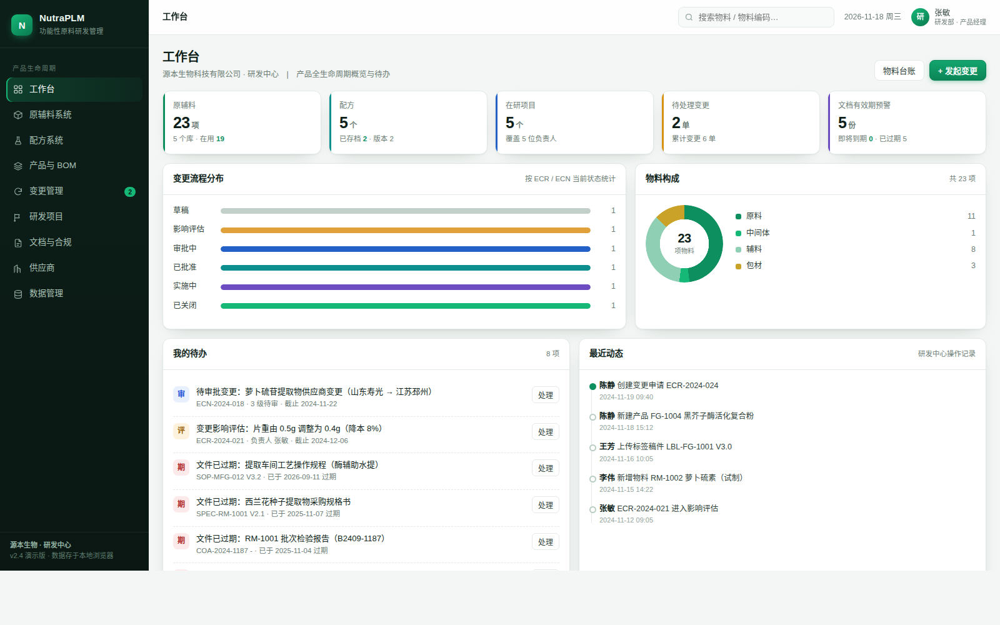

# NutraPLM · 功能性食品原料研发与产品全生命周期管理系统

面向**功能性食品 / 保健品原料制造**的轻量 PLM 系统：单文件 HTML，双击即用，数据保存在浏览器本地，无需服务器、无需安装依赖。



## 快速开始

```bash
git clone https://github.com/kameng19944/PLM.git
cd PLM
# 直接用浏览器打开 index.html 即可（推荐 Chrome / Edge）
```

或在线访问：**https://kameng19944.github.io/PLM/**（启用 GitHub Pages 后生效）

## 功能模块

| 模块 | 能力 |
|---|---|
| **工作台** | KPI 看板、变更流程分布、物料构成环形图、待办事项、操作动态 |
| **原辅料系统**（多库） | 5 个原辅料库统一管理；每项含**价格**、**功效成分**（含量+检测方法）、**营养成分表**、**法规使用依据**（类型/依据/适用范围/限量）、供应商与版本 |
| **配方系统** | 配方组成（用量 kg、损耗%）、按单价**自动折算原料成本 / 单位成本 / 每份成本**、营养折算、**配方表版本存档与快照对比** |
| **产品与 BOM** | 多阶 BOM 树（可展开、增删行）、用量损耗与成本自动折算 |
| **变更管理** | ECR/ECN 全流程：草稿 → 影响评估 → 多级审批 → 批准 → 实施 → 关闭，含影响物料追溯 |
| **研发项目** | Stage-Gate 阶段门（概念→小试→中试→稳定性→注册申报→量产导入）、里程碑、进度 |
| **文档与合规** | SOP/规格书/COA/法规文件版本管理、**有效期到期预警**（90 天临期 / 已过期） |
| **供应商** | 准入状态、资质证照、供货物料关联 |
| **数据管理** | 全量 JSON 备份/恢复、CSV 导出、一键重置演示数据、操作日志 |

## 批量导入原辅料

原辅料页 →「批量导入」：

- 支持 **CSV 文件** 或 **从 Excel / WPS 直接复制粘贴**（制表符自动识别）
- 内置**模板下载**与示例数据，粘贴后**逐行校验预览**（缺编码、单价非数字、文件内重复等即时标红）
- 重复编码可选**跳过**或**覆盖更新**；不存在的原辅料库**自动新建**
- 字段写法：功效成分 `名称|含量|方法`；营养成分 `能量=1480;蛋白质=28.5`；法规依据 `类型|依据|适用范围|限量`（多条用分号分隔）

## 演示数据

预置「西兰花种子提取物 → 萝卜硫苷 → 萝卜硫素」整条产品线的数据：23 项原辅料、5 个配方、4 个产品 BOM、6 个变更单、5 个研发项目、10 份文档、6 家供应商。

## 技术说明

- 纯前端：单个 `index.html`（HTML + CSS + 原生 JS），无框架、无构建、无外部依赖，可离线运行
- 数据持久化：`localStorage`，**仅存在本机浏览器**；清理浏览器数据会丢失，请先用「数据管理 → 导出全部数据」备份
- 兼容窄屏：窗口宽度 ≤1180px 时侧边栏自动收缩为图标条；支持 `Alt+1~9` 快捷键切换页面
- 无后端、无账号权限体系，定位为**单机演示 / 内部快速验证**版本

## 后续可扩展方向

- 后端服务 + 数据库，多人协作与角色权限
- 价格历史曲线与调价审批流
- 配方 BOM 与产品 BOM 打通、BOM 版本差异对比
- Excel (.xlsx) 直接导入、营养成分 NR% 计算
- 对接 ERP / LIMS

## License

内部演示项目，未指定开源协议。
