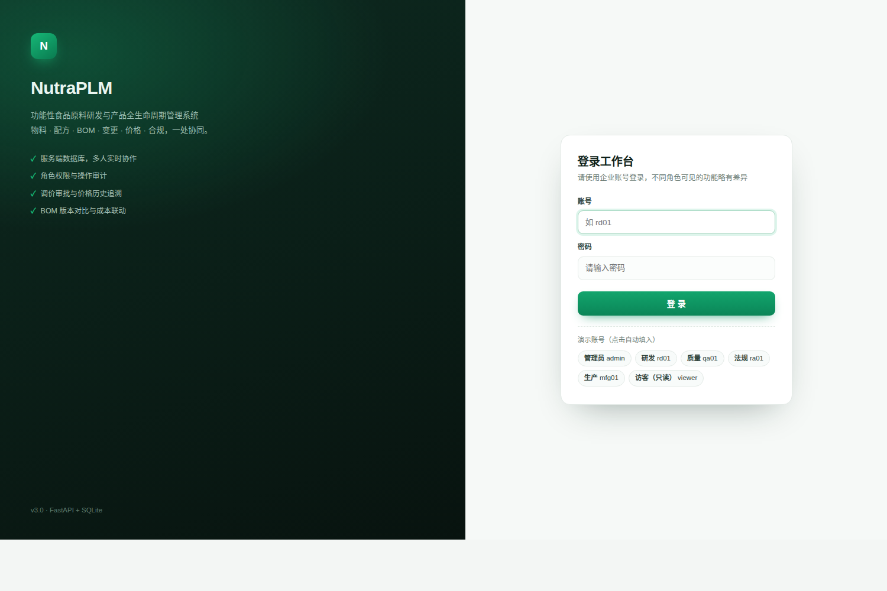
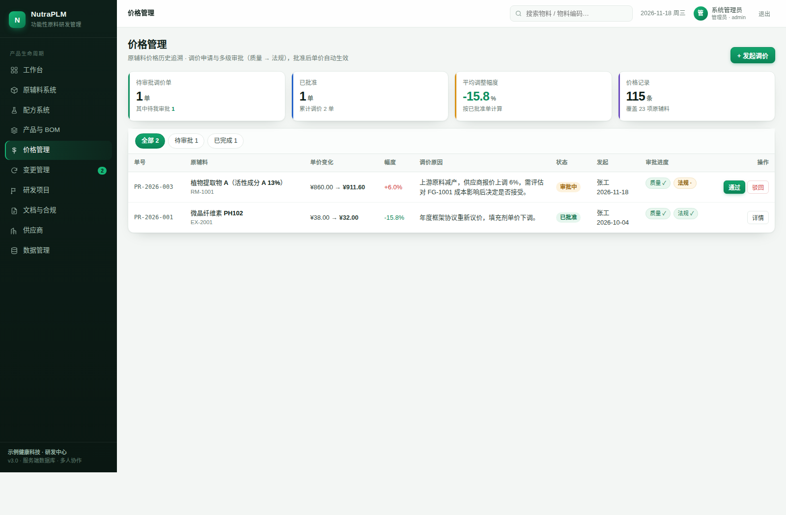

# NutraPLM · 功能性食品原料研发与产品全生命周期管理系统

面向**功能性食品 / 保健品原料制造**的 PLM 系统。v3 起为**前后端分离的多用户系统**：
FastAPI + SQLite 服务端数据库、账号登录、角色权限与操作审计，支持多人实时协作；
同时保留无后端的单机演示版。

| | |
|---|---|
| 登录与角色 |  |
| 价格管理与调价审批 |  |

## 快速开始

```bash
git clone https://github.com/kameng19944/PLM.git
cd PLM
bash run.sh          # 自动安装依赖并启动，打开 http://127.0.0.1:8000
```

需要 Python 3.10+。首次启动自动建库（`server/plm.db`）并写入脱敏演示数据。

### 演示账号

| 账号 | 密码 | 角色 | 权限要点 |
|---|---|---|---|
| `admin` | `admin123` | 系统管理员 | 全部权限、账号管理、可审批任一节点 |
| `rd01` | `rd123` | 研发工程师 | 原辅料 / 配方 / 产品 BOM / 项目维护，发起调价 |
| `qa01` | `qa123` | 质量经理 | 质量节点审批、文档与物料维护 |
| `ra01` | `ra123` | 法规专员 | 法规节点审批、合规文档 |
| `mfg01` | `mfg123` | 生产主管 | 项目阶段推进 |
| `viewer` | `view123` | 访客（只读） | 只读浏览，写入会被服务端拒绝 |

## 功能模块

| 模块 | 能力 |
|---|---|
| **工作台** | KPI 看板、变更流程分布、物料构成、待办、成员操作动态（服务端审计） |
| **原辅料系统**（5 库） | 价格、功效成分、营养成分表、法规使用依据、供应商与版本；多条件检索、CSV 导出 |
| **配方系统** | 用量 / 损耗 / 成本即时折算、营养加权折算 + **NRV%（GB 28050）**、配方表版本存档 |
| **价格管理** ★新 | 价格历史曲线、调价申请（**质量 → 法规两级审批**）、批准后自动生效并写入价格流水 |
| **产品与 BOM** | 多阶 BOM 树；**配方 ↔ 产品 BOM 一键同步**（按产量系数折算）；**BOM 版本存档与差异对比** ★新 |
| **变更管理** | ECR/ECN 全流程：草稿 → 影响评估 → 多级审批 → 实施 → 关闭 |
| **研发项目** | Stage-Gate 阶段门、里程碑、进度 |
| **文档与合规** | SOP / 规格书 / COA / 法规文件版本管理、到期预警 |
| **供应商** | 准入状态、资质证照、供货物料关联 |
| **数据管理** | JSON 备份导出导入、团队成员与角色一览、审计日志 |
| **批量导入** | CSV / Excel(.xlsx) ★新 / 粘贴表格，逐行校验预览、重复编码策略、自动建库 |

★新 = v3 新增。

## 架构

```
PLM/
├─ server/                # FastAPI 服务
│  ├─ app.py              # 接口 / 鉴权 / 调价审批 / BOM 版本 / xlsx 解析
│  ├─ seed.json           # 演示数据种子
│  └─ requirements.txt
├─ web/                   # 前端（原生 HTML/CSS/JS，零构建）
│  ├─ app.html            # 主应用
│  ├─ style.css
│  └─ enhance.js          # 登录 / 权限 / 价格 / BOM / NR% / Excel
├─ demo/offline.html      # 单机版演示（无后端，可双击打开）
├─ index.html             # 项目介绍页（GitHub Pages）
└─ run.sh                 # 一键启动
```

- **数据模型**：`entities`（七大类主数据）、`price_requests`（调价审批）、`price_history`（价格流水）、`bom_versions`（BOM 快照）、`users / sessions / audit_log`
- **并发控制**：整库提交 + 版本号校验（409 冲突时自动重载），页面每 15 秒轮询同步他人更新
- **权限模型**：前端按角色显隐按钮，**服务端按集合强制校验写权限**，审批流由专用接口保证原子性；所有操作写入审计日志
- **调价审批**：质量 → 法规两级，全部通过后单价生效并自动记录价格历史；驳回则保持原价

## 主要接口

```
POST /api/login | /api/logout          登录 / 退出
GET  /api/snapshot                     全量快照（含版本号）
POST /api/commit                       整库提交（版本校验 + 权限校验 + 审计）
POST /api/price-requests               发起调价
POST /api/price-requests/{id}/decide   审批（approve / reject）
GET  /api/price-history/{mid}          价格历史
POST /api/bom/{pid}/snapshot           BOM 版本存档
GET  /api/bom/{pid}/versions           版本列表
POST /api/import/xlsx                  Excel 导入解析
GET/POST /api/users, PATCH /api/users/{id}   账号管理（仅管理员）
GET  /api/audit                        审计日志
```

## 演示数据

预置一套**脱敏示例数据**（植物提取物 A → 标准化中间体 → 活性物 B 完整产品线，
企业 / 人员 / 供应商均为虚构）：23 项原辅料、5 个配方、4 个产品 BOM、6 个变更单、
5 个研发项目、10 份文档、6 家供应商、2 条调价单（1 条审批中）、2 个 BOM 版本、
6 个月价格历史。

## 单机版

`demo/offline.html` 为无后端的单文件版本（v2.4 功能集），双击即用、数据存浏览器本地，
适合快速演示；多人协作请使用 `run.sh` 启动完整版。

## 安全说明

- 演示密码仅用于本地体验，生产使用请修改 `server/app.py` 中 `DEFAULT_USERS` 并接入正式认证
- 所有演示数据均为脱敏示例，不含真实企业、供应商与价格信息
